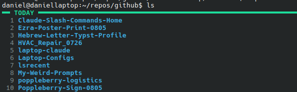
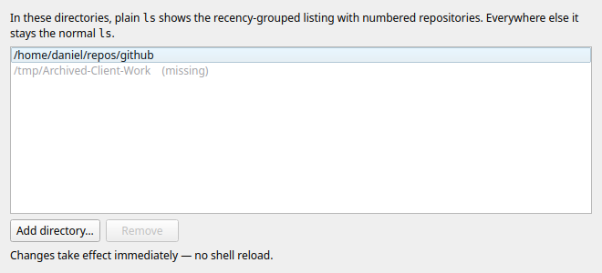

# lsrecent

A directory listing grouped by **recency** — with a built-in mechanism for making plain `ls` use it automatically in directories you choose.

Instead of one undifferentiated wall of names, entries are bucketed under conspicuous, color-coded headers by when they were last modified:

```
━━ TODAY ━━━━━━━━━━━━━━━━━━━━━━━━━━━━━━━━━━━━━━━━━━━━━━━  (bright green)
Laptop-Configs  Incoterms_Poster

━━ YESTERDAY ━━━━━━━━━━━━━━━━━━━━━━━━━━━━━━━━━━━━━━━━━━━  (green)
mqtt-mcp   palgate-multigate

━━ 2 DAYS AGO ━━━━━━━━━━━━━━━━━━━━━━━━━━━━━━━━━━━━━━━━━━  (cyan)
Hardware-Purchase-0726   thinkpad-e15-upgrades   android-unroot

━━ 3 DAYS AGO ━━━━━━━━━━━━━━━━━━━━━━━━━━━━━━━━━━━━━━━━━━  (cyan)
Wheres-My-Stuff-Deploy   Israel-Cable-Sourcing   Hebrew-Tech-Vocab

...                                                       (through 7 DAYS AGO)

━━ PAST MONTH ━━━━━━━━━━━━━━━━━━━━━━━━━━━━━━━━━━━━━━━━━━  (yellow)
My-Weird-Prompts   UniFi-OS-Server-Migration   laptop-nvme-upgrade

━━ PAST 3 MONTHS ━━━━━━━━━━━━━━━━━━━━━━━━━━━━━━━━━━━━━━━  (magenta)
...

━━ OLDER ━━━━━━━━━━━━━━━━━━━━━━━━━━━━━━━━━━━━━━━━━━━━━━━  (gray)
...
```

The top of a real listing — plain `ls` in `~/repos/github`, with the shell integration loaded:



The motivating use case: a `~/repos/github` directory with 250+ repositories filed under topic folders, where "what was I working on recently?" is the question a flat alphabetical listing cannot answer. The buckets answer it; inside a bucket the most recently opened repo is first, so the thing you were last in is line 1 — and `sn` at the prompt makes the bucket alphabetical when you are looking for a name instead. Entries are numbered straight down the listing and it ends by asking which one you want — type the number and you are in it. See [Choosing an entry](#choosing-an-entry).

## Install

### Debian package

```bash
git clone https://github.com/danielrosehill/lsrecent.git
cd lsrecent
./build-deb.sh
sudo apt install ./dist/lsrecent_*_all.deb
lsrecent shell-install      # once per user account; see below
```

Installs `/usr/bin/lsrecent`, `/usr/bin/lsrecent-gui`, man pages and a launcher entry. `python3-pyqt6` is a Recommends rather than a Depends, so the package still installs on a headless box without dragging Qt in; on a desktop, apt pulls it by default.

The package deliberately does not edit anyone's `~/.bashrc`. A root `postinst` has no business writing to user dotfiles and cannot know which accounts want the override, so `lsrecent shell-install` is a separate, per-user step — it appends the `eval` line, and does nothing if it is already there.

### From the source tree, no root

```bash
./install.sh
```

Copies `lsrecent` and `lsrecent-gui` to `~/.local/bin`, adds a launcher entry under `~/.local/share/applications`, and runs `shell-install` for you.

Pick one or the other. `~/.local/bin` usually precedes `/usr/bin` on `PATH`, so doing both leaves the from-source copy shadowing the package, and two installs that can drift is precisely the failure the [version handshake](#if-the-numbers-appear-but-nothing-asks-for-one) exists to catch.

### Either way

One line goes into your `~/.bashrc`:

```bash
eval "$(lsrecent shell-init)"
```

Nothing else is sourced from the repo — after install, the binary is self-contained and the clone can be deleted.

Requires bash 4.2+ and GNU coreutils (`stat -c`, `date -d`, `find -printf`, `realpath`) — i.e. any normal Linux. `fzf` is optional, needed only for the picker; `python3-pyqt6` only for the window. On macOS, install coreutils and adjust the `stat`/`date`/`find` calls.

## Usage

```bash
ls                    # grouped view, in directories you have opted in
lsr [dir]             # grouped view of dir (default: current directory)

lsrepos               # grouped view at repository level, across the whole tree
lstoday               # only the repos you opened today
lsyesterday           # only the repos whose last visit was yesterday
lsrepos --all         # the whole listing, past one screenful (-a works too)
lsrepos -A            # busiest-first within each bucket
lsrepos -n            # alphabetical within each bucket, not most-recent-first

lsrepos wms           # only the repos matching "wms", still grouped by recency
lsr wms               # the same, by the shortest route
lstoday claude        # today's work, narrowed

lsrecent noise        # what a tree-wide sweep is being stopped from dating

lsrp                  # fzf picker over every repo, then cd into it
lsrt / lsry           # same, restricted to today's / yesterday's
lsreg [args]          # plain ls, even where the grouped view is the default
```

Every repository listing ends with a prompt — type a number, press enter, and you
are in that repo. See [Choosing an entry](#choosing-an-entry).

Those are the shell functions `shell-init` defines, and they are what you want
interactively, because only a function running in your shell can `cd` it. Each
wraps the corresponding subcommand of the binary — `lsrecent`, `lsrecent repos`,
`lsrecent today`, `lsrecent yesterday`, `lsrecent pick` — which are what to call
from scripts: they list, and print, but never prompt.

### Searching from the command line

A positional argument written **like a path** — it has a slash in it, or it is `.`
or `..` — is the root to list. **Anything else is a search** over repository names
and paths:

```bash
lsrepos wms           # every repo matching "wms", grouped by recency as usual
lsr wms               # `lsr` is the alias for `lsrecent`, so this works too
lstoday claude
lsr ./wms             # ...and this still means the directory
```

The set is reduced **before** bucketing, so what prints is an ordinary grouped
listing that happens to contain only matches — numbered from 1, under the same
headers, answered by the same prompt, with the matched characters highlighted.
Filtering at the prompt instead would mean numbering 315 repositories in order to
show four of them.

**A search matching exactly one repository does not ask.** It prints the match and
cds there:

```
$ lsr noisy
━━ TODAY ━━━━━━━━━━━━━━━━━━━━━━━━━━━━━━━━━━━━━━━━━━━━━━━
  1 noisycity-api-blueprint
→ the only match · /home/you/repos/github/smart-home/noisycity-api-blueprint
$ pwd
/home/you/repos/github/smart-home/noisycity-api-blueprint
```

Deciding by "is it a directory?" instead of by "is it written like a path?" was
the obvious rule and the wrong one: it would make `lsrepos smart-home` mean
different things depending on which directory you were standing in, and would read
a bare repository name as a root the moment one happened to exist beside you. At a
tool whose job is jumping to repositories by name, a name means the name.

## Repository level

Listing a directory's immediate children stops being the right unit once repos
are filed under topic folders: it buckets *topics*, and topic folders are always
"recent" because any repo inside one keeps touching them. A topic folder is also
never the thing you want to open — it is filing, not work — and loose notes
sitting beside them are pure noise.

So **`lsrecent [dir]` picks the unit for you**:

- the directory contains repos below it → it lists **repositories**, wherever
  they sit in the tree, and nothing else (no topic folders, no stray files);
- the directory is itself a repo (`.git` present) → it lists **children**, files
  included, because there the files *are* the content.

`lsrecent repos` forces the repository view explicitly:

```
━━ TODAY ━━━━━━━━━━━━━━━━━━━━━━━━━━━━━━━━━━━━━━━━━━━━━━━
  1 Cloud-Mounts        2 Driving-Checklists   3 HVAC_Repair_0726
  4 lsrecent            5 AI-Gateway-Manager    6 Twilio-Manager

━━ 3 DAYS AGO ━━━━━━━━━━━━━━━━━━━━━━━━━━━━━━━━━━━━━━━━━━
 31 DSR-Holdings-Cloud  32 dsrholdings-accounting-plugin   ...
```

A repo is any directory containing `.git`, found strictly *below* the root — a
root that is itself a repo is not listed among the repos under it. The root
defaults to `$LSRECENT_REPO_ROOT`, else `~/repos/github`, else `~/repos`; search
depth is `$LSRECENT_REPO_DEPTH` (4). Names are shown as bare basenames because
they are normally unique; `--full` shows `topic/repo` instead.

### A bucket per day for the last week

The recent end of the listing is bucketed by **calendar day**, not by span:

| | |
| --- | --- |
| *TODAY* | since local midnight |
| *YESTERDAY* | the previous calendar day |
| *2 DAYS AGO* … *7 DAYS AGO* | one bucket each |
| *PAST MONTH*, *PAST 3 MONTHS*, *OLDER* | everything beyond a week |

"Today or yesterday?" was always the question these views answer, and it does not
stop being the question at 48 hours — *four days ago* is a place in your week, and
you can generally say what you were doing there. A single *PAST WEEK* bucket threw
that away and handed back the undifferentiated heap the grouping exists to break
up: on a tree of 250 repos it was routinely the largest group on the screen.

Empty days are simply not printed, so a quiet week costs nothing; a busy one is
longer than the old listing, which is the trade — [the fold](#one-screenful-by-default)
still cuts it to a screenful and everything below it is still numbered. All six
day buckets share the one cyan header colour: the colour says *how* recent,
coarsely, and the label says which day.

Boundaries are local midnights, computed without forking `date` — see
[Today and yesterday do not overlap](#today-and-yesterday-do-not-overlap) for how
that survives a DST week.

### Ordering: buckets by recency, and recency inside them too

The **buckets** run newest-first, and that is where most of the recency lives:
*TODAY* before *YESTERDAY* before *2 DAYS AGO*, and a repo sits in exactly one of
them. **Inside** a bucket the default is **most recently opened first** (since
1.12.0; it was alphabetical from 1.10.0 to 1.11.0).

The case for alphabetical was that a day bucket is all one day, so which of two
repos was touched at 14:02 and which at 11:40 is a distinction you cannot predict,
and ranking on it moves a name around between listings for reasons nothing on
screen explains. That still holds for *PAST MONTH* and below. It does not hold for
*TODAY*, which is the bucket the tool exists for and is read top-down: the last
thing you were in is nearly always the thing you are going back to, and it should
be line 1 rather than wherever its initial falls. `sn` at the prompt is one
keystroke away when you want the alphabet back.

There are four orders. `s` at the prompt cycles them, and `sr` / `sf` / `sv` /
`sn` jump straight to one, without leaving the listing:

| Flag | Prompt key | Order inside a bucket |
| --- | --- | --- |
| `--recency` (`-t`) | `sr` | most recently opened first — **the default** |
| `--frecency` (`-f`) | `sf` | visits first, most recent breaking the ties |
| `--visits` (`-A`) | `sv` | busiest first: how many times you opened it *that day* |
| `--name` (`-n`) | `sn` | alphabetical, case-insensitive |

**Frecency is the two signals together**, because neither alone is the question
you are asking. The repo you opened nine times today beats the one you opened
once at lunch; among repos with equal visits the newest wins. It differs from
`sv` exactly at the ties, and the ties are most of a bucket: `sv` sends them to
the alphabet, `sf` leaves them in recency order, so a bucket nobody visited looks
like `sr` rather than like `sn`.

`--time` and `--activity` are the older spellings of `--recency` and `--visits`
and still work, as do `LSRECENT_SORT=time` and `=activity`.

```bash
lsrepos -A            # the busiest repo of each day at the top of its bucket
lstoday -n            # today's work, alphabetical
```

**`ss` keeps the order you are looking at.** Which order you want is not a
question you answer in the abstract — you answer it by pressing `s` until the
screen looks right, and at that moment the answer is on the screen and one
keystroke from being lost. `ss` writes it to the [settings
file](#settings-that-outlive-the-shell), so every listing from then on starts in
it. `lsrecent config set sort visits` is the same thing said outright, and
`export LSRECENT_SORT=name` still overrides both for one shell.

**Activity is visits, counted inside the bucket's own day.** A day bucket ranks by
how many times the [visit log](#opened-today-and-the-visit-log) recorded you
opening the repo *on that day*, so "busiest" means the same thing in every row of
the listing rather than rewarding whatever you have been using all month. The
coarse buckets — *PAST MONTH*, *PAST 3 MONTHS*, *OLDER*, *UNDATED* — have no single
day to count, so they count the whole log and rank by how often you go back to the
thing at all.

It is deliberately a count of *visits*, not of edits or of commits: a visit is the
one thing recorded per event rather than inferred from a timestamp, so it can be
counted. A day you dipped into forty repositories and worked in four looks, in any
order but this one, like forty equal repositories; `-A` puts the four at the top.
Repos with no visits that day score zero and fall to the bottom in alphabetical
order — so a bucket nobody visited looks exactly like `-n`, rather than shuffling
for no visible reason.

`s` re-prints the listing rather than re-ordering it in place, which renumbers it:
a number is a position in *a* ranking, and changing the order makes a new one. The
new listing prints above the prompt the way running the command again would, and
the old one stays in the scrollback.

One consequence is worth knowing: when a listing is cut to one screenful, the
bucket at the fold is cut where the current order puts the fold — under `sn` what
is missing from it is *M–Z* rather than *the oldest*. Whole buckets are still dropped
oldest-first, and everything cut is still numbered and reachable from the prompt
by search or `+` — see [One screenful by default](#one-screenful-by-default).

## Choosing an entry

Repository listings are numbered straight down the listing — `1` is the first repo
of *TODAY*, and the count keeps running through *YESTERDAY*, *2 DAYS AGO* and the
rest rather than restarting per bucket.

**A listing is a question, so it ends by asking it.** Type a number, press enter,
and the program has done its job — you are standing where you wanted to be:

```
$ ls
━━ TODAY ━━━━━━━━━━━━━━━━━━━━━━━━━━━━━━━━━━━━━━━━━━━━━━━
  1 Driving-Checklists  2 HVAC_Repair_0726     3 lsrecent
→ number, text to search, n/p pages, s sort, ? help, enter stays: 2
/home/you/repos/github/home-and-property/HVAC_Repair_0726
$ pwd
/home/you/repos/github/home-and-property/HVAC_Repair_0726
```

Enter on its own — or `q`, or ctrl-d — stays put. A number outside the ranking, or
a repo deleted since it was printed, re-asks rather than failing.
`LSRECENT_PROMPT=0` turns the prompt off and gives you the listing alone.

### The prompt is also a browser

One screenful is twenty-odd repositories and the ranking behind it is often
hundreds long, so a prompt that only accepted a number could not reach most of
what it had just numbered. It accepts more than a number:

| Reply | Does |
| --- | --- |
| `23` | cd into entry 23 — **numbers are the ranking, not the page** |
| `text` | search labels and paths for `text`, case-insensitive, best match first |
| `/` | clear the search, back to the full ranking |
| `n` or `+` | next page |
| `p` or `-` | previous page |
| `t` | back to the top of the current view |
| `a` | everything in the current view, unpaged |
| `s` | cycle the order inside each group: recency → frecency → visits → name |
| `sr` / `sf` / `sv` / `sn` | go straight to that order — recency, frecency, visits, name |
| `ss` | **keep** the order in force — every listing starts in it from now on |
| `?` | the same summary |
| enter, `q`, ctrl-d | stay put — except that enter takes the **only match** of a search |

Every key the tool offers — here, on the prompt line, in the paging footer — is
printed in its **own colour**, distinct from the prose describing it, and the
order currently in force is a third colour again. A hint line is part instruction
and part explanation; in one colour the two fuse and you have to read the sentence
to find the character you are meant to press.

A bare word searches. Nothing else a selection could be is anything but digits, so
typing a repository name at a prompt that has just listed repository names does
what you meant:

```
$ ls
━━ TODAY ━━━━━━━━━━━━━━━━━━━━━━━━━━━━━━━━━━━━━━━━━━━━━━━
  1 Driving-Checklists  2 HVAC_Repair_0726     3 lsrecent
 …
… 238 more, numbered 21-258 · n pages to them, lsrepos --all prints them
→ number · text to search · n/p pages · s sort (recency) · ? help · enter stays: noisy
 79 noisycity-api-blueprint
… the only match · enter goes there · / clears the search
→ number · text to search · n/p pages · s sort (recency) · ? help · enter stays:
/home/you/repos/github/smart-home/noisycity-api-blueprint
```

**Results are ranked, and the match is lit up.** Four tiers, best first: the whole
name, then names starting with what you typed, then names containing it, then
entries whose *path* matched but whose name did not. Inside a tier the listing's
own order survives, so the best answer is at the top and the rest are still
newest-first underneath it. The characters that matched are highlighted inside the
name — and a row with no highlight is telling you it is here on its path, not its
name. Typing `wms` and finding `Wheres-My-Stuff` fourth, under three repos whose
paths happen to contain those letters, is a search failing while appearing to
work.

**One match left standing, and enter takes it.** Otherwise enter still means stay
put, and `q` and ctrl-d always do — the offer is only ever made on the footer line
that says so.

`79` was never on screen. The search matches the path as well as the label, so a
topic name (`smart-home`) collects everything filed under it even though the topic
is not part of a bare basename.

Numbers survive all of it. Filtering and paging move a window over the ranking
rather than renumbering it, so `79` means the same repository on the first screen,
inside a search, on page four, and via `lsrecent path 79` tomorrow.

`s` is the one exception, and openly so: a number is a position in *a* ranking, so
re-ordering makes a new one. It prints a fresh listing above the prompt — the way
running the command again would — and says `renumbered` while doing it.

It stays line-oriented rather than becoming a full-screen application, which is a
deliberate trade. The premise of the tool is that the listing lands in your
scrollback and stays useful there — an alternate-screen TUI would wipe it on exit,
taking the numbers with it. So each page prints and scrolls like any other command
output — including `p`, which prints the previous page again below rather than
scrolling up to where it already is. That is not the duplication it would be in a
pager: a number *is* the ranking, so an entry printed twice is the same repository
with the same number both times, and walking back down the list should leave the
same trail in the scrollback that walking up it did.

Pages are a fixed length within a view, measured over the whole view rather than
over the slice about to be printed. That is what makes `n` and `p` inverses of each
other — sized off the visible slice, a page's length depended on the longest label
still ahead of it, so its boundaries moved with the direction of travel — and it
also keeps the columns lined up from one page to the next.

The prompt appears only where something can act on the answer: a listing on a
terminal, run through the shell integration. Piped or redirected it lists and exits,
so `lsrecent repos | wc -l` and scripts behave exactly as before. On a terminal but
without the integration it says so instead of prompting — see below.

### If the numbers appear but nothing asks for one

```
→ cd-by-number needs the shell integration reloaded (shell has 1.5.0, binary is 1.5.1)
```

The binary is upgraded in place; a shell keeps whatever `shell-init` defined when it
started. Upgrade while a terminal is open and that terminal is left holding the old
functions — which, if they predate the prompt, never set `$LSRECENT_CD_FILE`, so the
listing prints its numbers and simply ends. Nothing is broken and nothing is wrong on
screen, which is what makes it worth an explicit message.

`shell-init` therefore exports `LSRECENT_SHELL` with its own version, and the binary
compares it. `source ~/.bashrc`, or open a new terminal, and it is gone. To ask
directly:

```
$ lsrecent --version
lsrecent 1.5.1 (shell integration: 1.5.0 — stale, run `source ~/.bashrc`)
```

which also reports `loaded` or `not loaded in this shell`.

Re-sourcing into an old shell used to fail outright rather than merely lag. Up to
1.1.1 the grouped views were aliases; from 1.2.0 they are functions. An interactive
shell expands aliases before the parser sees `lsrepos()`, so with the 1.1.1 alias
still resident, `source ~/.bashrc` died on

```
bash: eval: line NNN: syntax error near unexpected token `('
bash: eval: line NNN: `lsrepos()     { __lsrecent_list repos "$@"; }'
```

and — the part that matters — `eval` abandons the rest of the string, so every
function after that line silently never got defined. Since 1.7.1 `shell-init`
begins by unaliasing the names it is about to define, so it can always land on top
of any earlier vintage. In a shell that predates 1.7.1, `unalias lsrepos lstoday`
first, or just open a new terminal.

### Why the answer travels through a file

A process cannot `cd` its parent shell — the working directory is per-process, and
a child changing its own is lost when it exits. So the work is split: the binary
prints the listing and reads the reply from `/dev/tty`, then writes the chosen
absolute path to the file named in `$LSRECENT_CD_FILE`; the shell function that set
that variable reads the file and does the `cd` itself, in your shell.

Three separate channels, deliberately. Stdout is the listing and may be a pipe;
stdin may be anything at all; so the prompt gets `/dev/tty` and the answer gets a
file of its own. The file is named for the shell's PID (`…/lsrecent/cd.$$`) so two
terminals listing at once cannot read each other's answer, and it is a fixed name
rather than `mktemp` to keep the bare-`ls` path fork-free. It is removed as soon as
it is read; `lsrecent prune` sweeps any left by a shell that died mid-prompt.

### The numbers also stay bound

After the prompt is gone the numbers still work, for the case where you glance at a
listing, do something else, and then decide:

```
$ lstoday
━━ TODAY ━━━━━━━━━━━━━━━━━━━━━━━━━━━━━━━━━━━━━━━━━━━━━━━
  1 HVAC_Repair_0726   2 lsrecent
→ number to cd, enter to stay:
$ git -C ~/notes pull
$ 2                       # still goes where 2 pointed
```

Each listing writes its numbering to
`${XDG_DATA_HOME:-~/.local/share}/lsrecent/last-list` as `<n>\t<path>` lines, and
`lsrecent path N` resolves a number against it (erroring if the path has since
been deleted). The map covers the whole ranking, not just the printed screenful.
The numbers themselves are shell *functions* named `1`, `2`, … — bash permits that
— defined by `shell-init`'s `__lsrecent_bind_numbers`, which is re-run after every
listing so stale numbers are unbound rather than left pointing somewhere wrong. It
defines them in a single `eval` because a full listing here is a couple of hundred
of them, not twenty.

The obvious-looking alternative, `command_not_found_handle`, cannot work:
bash runs that handler in a forked subshell, so any `cd` it performs dies with the
fork. Numbers are only bound by listings run through the shell integration (bare
`ls`, `lsrepos`, `lstoday`, `lsyesterday`); `lsrecent repos` invoked directly still
writes the map, but a subprocess cannot define functions in your shell.

## One screenful by default

250 repositories is 130 rows of output, which scrolls the answer off the screen
and takes your scrollback with it. Repository listings therefore stop when the
screen is full and tell you what they left out:

```
━━ 4 DAYS AGO ━━━━━━━━━━━━━━━━━━━━━━━━━━━━━━━━━━━━━━━━━━
 31 DSR-Holdings-Cloud   32 dsrholdings-accounting-plugin
 33 Israel-Cable-Sourcing   34 Hebrew-Tech-Vocab
… 219 more, numbered 35-253 · lsrepos --all to see them
```

**Cutting the listing does not cut the numbering.** Every repo in the ranking gets
a number whether or not it fit on the screen, which is why the footer gives the
range it elided: `35` at the prompt cds into the thirty-fifth repo even though you
never saw its name, and the path is echoed so you can see where you landed. `--all`
is for when you want to read the names, not a precondition for reaching them.

Truncation is sound because the groups run newest-first: cutting from the end
drops the buckets you are least likely to want, whole. Only the bucket at the
fold is cut part-way, and there the cut lands wherever the
[within-group order](#ordering-buckets-by-recency-and-recency-inside-them-too) puts it —
by recency, unless `-n` or `-A`. Everything in that bucket is the same age anyway, and
nothing cut is unreachable: it is numbered, and the prompt searches and pages.
Once anything has been cut the remaining groups are only counted, never partially
shown — printing *OLDER* after eliding half of *PAST MONTH* would misrepresent
the recency order the whole view is built on.

The budget is the terminal height less three rows, so the listing, the footer and
your prompt all land on one screen. To change or defeat it:

```bash
n                          # at the prompt: next page, no re-run (p goes back)
a                          # at the prompt: the rest of the view, unpaged
lsrepos --all              # or -a: no limit
LSRECENT_MAX_ROWS=60 ls    # explicit budget; 0 means unlimited
lsrepos --all | less -R    # if you want a real pager
```

A **redirected or piped** listing is never truncated — `lsrecent | wc -l` sees all
255, the same way `ls` drops its columns when it is not talking to a terminal.

None of this is the only way past the fold, and usually not the best one: the
prompt itself pages with `n` and `p` and searches by name, so the elided repos are
reachable without re-running anything. See [the browser](#the-prompt-is-also-a-browser).

A pager is deliberately not the default. It would take over the screen and demand
a `q` for a listing you wanted to glance at, and the numbers are only useful while
they are still visible in front of your prompt.

Note that the **directory-level** view (inside a repo) is not budgeted; it still
prints in full, because it delegates its layout to `ls -C`, which packs
column-major — cutting rows off the bottom there would drop a scattered subset
rather than the oldest entries.

## Getting a plain listing anyway

`lsreg` is the escape hatch — plain `ls` with normal colors, taking the same
arguments, in a directory where the grouped view is the default:

```bash
lsreg          # conventional listing here
lsreg -la      # any ls flags
```

`ls` with any argument already falls through to real `ls`, so `lsreg` is for the
case where you want the *no-argument* listing unmodified.

## "Opened today" and the visit log

`repos` and `today` / `yesterday` mean different things by recency, deliberately.

**`repos` uses activity**: the newest of three signals —

| Signal | Means |
| --- | --- |
| a recorded visit | you opened it. The only direct evidence there is |
| the repo directory's mtime | a file was added or removed at the top level |
| `.git/logs/HEAD`'s mtime | HEAD moved: a commit, checkout, merge, pull or reset |

The reflog rather than `.git` itself, which is what this used until 1.11.0 and
which turned out to mean almost nothing. **A directory's mtime moves when an entry
inside it is created or removed**, so every lock file, every `gc.log`, every temp
file any tool writes next to the index counts as "I worked here" — and one command
run across the whole tree makes all of them today's. Measured here on 2026-08-08,
a single sweep had moved the `.git` mtime of **300 of 303** repos while the
worktree mtime had moved for 14 and `logs/HEAD` for 15. *TODAY* had three hundred
repositories in it, which is the same as having none.

`.git/index` is excluded for a weaker version of the same reason — `git status`
rewrites it, 66 repos that day — and `.git/FETCH_HEAD` because a fetch is not work,
and `git fetch` run across every repo is precisely the sweep this is trying not to
be fooled by. A `pull` moves HEAD and is caught by the reflog regardless.

### When something touches everything at once

The three signals above are as honest as the filesystem gets, but a mass `git
pull`, a restore from backup or a tree-wide `chmod` can still date every repo to
the same instant, and no per-repo signal can tell that apart from a very busy day.
The shape of it can: **a calendar day whose *inferred* dates cover more than half
of all repos is treated as a bulk touch.** Those dates are discarded, the repos
land in an *UNDATED* bucket at the bottom instead of *TODAY*, and the listing says
so:

```
━━ UNDATED ━━━━━━━━━━━━━━━━━━━━━━━━━━━━━━━━━━━━━━━━━━━━━
 21 android-unroot   22 Cloud-Mounts   23 Dev-Env-Sweeper  ...
↯ 287 repos dated only by a bulk touch on 2026-08-08 — UNDATED, not recent
  work · `lsrecent noise remove 2026-08-08` trusts that day again
```

**Visit-log dates are never discarded**, which is what makes the rule safe: a
command run across every repo opens none of them, so a day you genuinely spent in
fifty repositories is not at risk, and a repo caught in the sweep that you *did*
open that day is dated by the visit and stays in *TODAY*. Suppression falls on the
signal, not on the repository.

*UNDATED* is honest rather than convenient: the sweep destroyed the information,
so the answer is "no longer known", not a guess. It sorts last and is therefore the
first bucket [the fold](#one-screenful-by-default) drops.

```bash
lsrecent noise                    # what is suppressed, and why
lsrecent noise add                # today was a sweep — I know, you did not
lsrecent noise add 2026-07-30     # some other day
lsrecent noise remove 2026-08-08  # no it wasn't; trust that day again
export LSRECENT_NOISE_PCT=70      # a stricter threshold (0 disables the rule)
```

`noise remove` records the day as *trusted* rather than merely deleting it,
because an auto-detected day would otherwise be re-detected on the next listing.
The list is `${XDG_CONFIG_HOME:-~/.config}/lsrecent/noisy-days` — one `YYYY-MM-DD`
per line, `!YYYY-MM-DD` for a trusted one.

**`today` uses only the visit log** — literally the repos you `cd`'d into today.
mtime cannot answer that question: entering a repo touches nothing, and editing
a nested file leaves the repo directory's mtime alone. Backups, indexers and
tree-wide `chmod`s all forge it in the other direction. On this machine, mtime
alone put 24 repos in "today"; the visit log put 3.

The log is `${XDG_DATA_HOME:-~/.local/share}/lsrecent/opened.log`, one
`<epoch>\t<path>` line per visit, appended by a `PROMPT_COMMAND` hook whenever
`$PWD` changes and `$PWD/.git` exists. It is compacted automatically past 5000
lines (last visit per path wins, entries older than 180 days and paths that no
longer exist are dropped); `lsrecent prune` forces it.

The hook is the one piece of real logic that lives in the shell rather than the
binary, because it runs on every prompt and must not fork — it is a `[[ -e ]]`
test and a `printf` append, using bash's `EPOCHSECONDS`. `lsrecent visit [dir]`
does the same thing as a subprocess, for non-bash shells.

**It only records from the moment it is installed.** A fresh install has an
empty log, and `today` will say so rather than silently showing nothing.

### Today and yesterday do not overlap

`lsyesterday` is `lstoday` for the previous calendar day, and the two lists are
disjoint: **a repo you opened yesterday and again today is today's, and appears in
no other list.** Every repo has exactly one timestamp — its *newest* visit — and
that timestamp falls in exactly one day. So the question the pair answers is "when
did I last have this open?", and each repo answers it once. If it were "was this
open at any point yesterday?", most of yesterday's list would be a duplicate of
today's, which is precisely the noise these views exist to remove.

The same logic is what lets the ordinary `lsrepos` listing carry
[a bucket per day](#a-bucket-per-day-for-the-last-week): one timestamp per repo
means the days are mutually exclusive by construction, so no repo is ever printed
twice and the numbering can run straight down them.

Day boundaries are local midnights, computed with bash's own `printf '%(%H)T'`
rather than by forking `date`, since bare `ls` goes through this path. Each is
*snapped to* rather than reached by subtracting 86400, and the eight boundaries a
listing needs are walked one day at a time rather than multiplied out, so a week
containing a DST change still has seven days in it instead of drifting an hour
further out with each one. Verified against all 365 days of 2026 in eight zones —
23,360 boundaries, no mismatches — including 30-minute DST (Lord Howe) and the
southern hemisphere. `scripts/verify-day-boundaries.sh` is that check; re-run it
if you touch `snap_midnight` or `day_midnights`. Zones that transition *at*
midnight, such as America/Santiago, land within the hour twice a year; nothing
here cares.

## Settings that outlive the shell

Every tunable already existed as an `LSRECENT_*` environment variable, and a
variable is the right shape for *this shell, this listing*. It is the wrong shape
for *this is how I like it*: four exports in `~/.bashrc` are a preference recorded
in a file about shells, invisible to the tool that obeys it and unwritable by it —
so `s` at the prompt could find the order you wanted and then had nowhere to put
it. Since 1.14.0 there is a file, holding the same settings under shorter names.

```bash
lsrecent config                      # every setting, its value, and where that value came from
lsrecent config set sort visits      # ... or press ss at the prompt
lsrecent config unset sort
lsrecent config get repo_root
lsrecent config edit                 # the file in $EDITOR
lsrecent config path
```

| Setting | Variable | Accepts | Default |
| --- | --- | --- | --- |
| `sort` | `LSRECENT_SORT` | `recency`, `frecency`, `visits`, `name` | `recency` |
| `prompt` | `LSRECENT_PROMPT` | `0`, `1` | `1` |
| `max_rows` | `LSRECENT_MAX_ROWS` | a number, `0` for unlimited | as many as the screen has |
| `noise_pct` | `LSRECENT_NOISE_PCT` | 0–100 | `50` |
| `repo_root` | `LSRECENT_REPO_ROOT` | a path | `~/repos/github`, else `~/repos` |
| `repo_depth` | `LSRECENT_REPO_DEPTH` | a number | `4` |

**A flag beats the environment, the environment beats the file, the file beats the
default.** So an export is still how you say "just this shell" and the file is how
you say "always", and neither had to be taught about the other: the loader fills
in the `LSRECENT_*` variables that are *not already set*, and every
`${LSRECENT_X:-default}` in the rest of the script goes on reading what it always
read.

That ordering has one failure mode worth designing against — writing a preference
that is silently outranked by an export you made months ago and forgot. So
`config set`, `config unset` and `ss` all say so when the variable is set in the
current shell, rather than reporting a success that will not be visible.

The file is `${XDG_CONFIG_HOME:-~/.config}/lsrecent/config`, `key = value`, one
per line. A `#` starts a comment when it opens the line or follows a space, so a
path may contain one. It is meant to be edited by hand as much as by `config
set`, which is why `config set` rewrites it line by line and leaves your comments
and ordering alone.

```
# my own note
sort = visits
repo_depth = 3   # inline comments work
```

A line the file gets wrong — an unknown setting, a value out of range, something
that is not `key = value` at all — is **ignored and reported on every run** until
it is fixed. Not fatal, because the file is read by every bare `ls` in an override
directory and one stale typo should not take your shell prompt with it; not
silent, because falling back to the default without saying so is the failure that
looks like success. The two commands that must never print — `check`, which the
`ls` wrapper runs on every prompt, and `visit`, which runs on every directory
change — stay quiet, and neither reads a setting anyway.

It is parsed in-process rather than `source`d. Sourcing would have been three
lines shorter and would have made the config file a shell script, in which a typo
is an arbitrary command and `repo_root = $(rm -rf ~)` is a valid setting.

## The picker

`lsrp` lists every repo newest-first in `fzf` and `cd`s into what you choose;
`lsrt` restricts the list to today's and `lsry` to yesterday's. The preview pane
shows the last 8 commits and `git status -sb`. All three are shell functions from
`shell-init`, because `cd` has to happen in your shell — `lsrecent pick` itself
just prints the chosen absolute path, so it composes with anything else.

The picker is for searching by name when you know what you are after. The numbered
prompt is for the far commoner case of picking off a short recency-ordered list, and
needs no dependency and no fuzzy-matching in your head.

Since the prompt [searches too](#the-prompt-is-also-a-browser), the two overlap more
than they used to, and reaching for `lsrp` is no longer the answer to "it wasn't on
the screen". What the picker still has is fuzzy matching, the commit/status preview
pane, and a scrolling result list you can arrow through — worth it when you are
hunting rather than returning. The prompt's search is a plain case-insensitive
substring, which is what you want when you already know the name.

`fzf` is the tool's only optional dependency — the picker needs it, everything
else works without it.

## The override mechanism

The point of the system: in *chosen* directories, bare `ls` shows the grouped view without you remembering a special command — while behaving completely normally everywhere else.

The binary is its own backend. It manages an include-list and answers membership queries; the shell wrapper is a four-line function that asks it.

### Managing the include-list

| Command | Effect |
|---------|--------|
| `lsrecent add` | Enable the grouped view for the **current** directory |
| `lsrecent add /some/path` | Enable it for another directory |
| `lsrecent remove` (or `rm`) | Disable it for the current directory |
| `lsrecent remove /some/path` | Disable it for another directory |
| `lsrecent list` | Print every directory with the override enabled |
| `lsrecent edit` | Open the include-list in `$EDITOR` |
| `lsrecent gui` | Manage the same list in a window |
| `lsrecent check [dir]` | Exit 0/1 depending on whether the override is enabled (for scripting) |
| `lsrecent shell-install` | Append the `eval` line to `~/.bashrc` (idempotent) |

Changes take effect at once — the include-list is consulted on every `ls`, so there is nothing to reload in shells that are already open.

### The window

```bash
lsrecent gui
```

Also in the application launcher as **lsrecent Directories**. A list of the opted-in directories, an *Add directory…* chooser, and *Remove* — that is the whole surface, because that is the whole of the mapping.



Two things it does that the CLI does not: entries whose directory has since been deleted or renamed are flagged `(missing)`, which is otherwise invisible — `ls` simply never triggers there and the include-list still looks right — and the status line quotes the binary's own reply, so *"already enabled for …"* reads the same in both places.

It is a front end and nothing more: rows come from `lsrecent list`, changes go out through `lsrecent add` / `lsrecent remove`, and the list is re-read after each. The file format, tilde expansion, `realpath` resolution and deduplication stay in the binary, since a second implementation in another language is how the two come to disagree. It needs `python3-pyqt6`; the CLI does not.

`shell-init` passes `COLUMNS` and `LINES` through explicitly — interactive bash
sets both but exports neither, and without them the binary cannot size its columns
or its row budget without forking `tput`.

`shell-init` also defines the `lsr-add`, `lsr-remove` and `lsr-edit` aliases,
`lsreg`, the `lsrp` / `lsrt` / `lsry` picker functions, and `lsrepos` / `lstoday` /
`lsyesterday`. Those last three, and the `ls` wrapper, all go through one
`__lsrecent_list` helper: they have to `cd` to wherever the prompt was answered and
bind the numbers they printed, and both of those must happen in your shell, which
rules out aliases.

`add` validates that the path exists, resolves it with `realpath` (so relative paths and symlinks work), and deduplicates. Changes take effect immediately in every open shell — the list is consulted on each `ls`, so there is nothing to reload.

### Where state lives

`${XDG_CONFIG_HOME:-~/.config}/lsrecent/dirs` — created on first `add`. Deliberately a plain-text file, one absolute path per line (`#` comments and blank lines ignored, leading `~` expanded):

```
# lsrecent include-list
/home/you/repos/github
/home/you/Documents/projects
/mnt/archive/clients
```

`${XDG_CONFIG_HOME:-~/.config}/lsrecent/noisy-days` — created on first `noise add` or `noise remove`. Same shape, one `YYYY-MM-DD` per line, `!YYYY-MM-DD` for a day that must never be auto-suppressed. See [When something touches everything at once](#when-something-touches-everything-at-once).

`${XDG_CONFIG_HOME:-~/.config}/lsrecent/config` — created on first `config set` or `ss`. `key = value`, one per line. See [Settings that outlive the shell](#settings-that-outlive-the-shell).

Plain text rather than JSON because a pure-bash tool shouldn't need `jq` or Python to read its own state, and the file stays trivially hand-editable, greppable, and dotfile-manager-friendly. The CLI is the intended interface; manual edits are equally valid.

### How the `ls` override works

`eval "$(lsrecent shell-init)"` installs this wrapper:

```bash
ls() {
    if (( $# == 0 )) && [[ -t 1 ]] && lsrecent check 2>/dev/null; then
        __lsrecent_list          # lists, prompts, cds where you said
    else
        command ls --color=auto "$@"
    fi
}
```

- **Any arguments → real `ls`.** `ls -la`, `ls somedir` are untouched.
- **Non-terminal stdout → real `ls`.** Pipes and scripts (`ls | grep foo`) never see the grouped view or its ANSI codes.
- **Otherwise** the binary is asked whether `$PWD` is on the include-list.

Matching is exact — no subdirectory inheritance. Enabling `~/repos/github` does **not** change `ls` inside `~/repos/github/some-project`; inside a project you usually want a conventional listing.

Because the wrapper's logic lives in the binary (`shell-init`, `check`), updating the binary updates the behavior everywhere — the repo/binary is the single source of truth, and your `.bashrc` never needs to change again. The one thing that does not update itself is the wrapper *already loaded* into a shell that is open at the time; it is replaced at the next `source ~/.bashrc`, and until then the binary says so rather than behaving oddly ([above](#if-the-numbers-appear-but-nothing-asks-for-one)).

## Design notes

- **Buckets:** *Today* and *Yesterday* are calendar days (not "last 24 h" / "24–48 h ago"), then ≤ 7 days, ≤ 30 days, ≤ 90 days, older. Empty buckets are omitted. Membership is decided by comparing against local midnight epochs, not by formatting each timestamp. One timestamp per entry means the buckets are mutually exclusive, which is what lets *Today* and *Yesterday* be answers rather than overlapping windows.
- **A listing is a question.** Anything that numbers its output should be willing to take a number back, so the prompt is the default rather than a flag: the alternative is a tool that shows you the answer and then makes you retype part of it. The non-interactive path still exists for pipes and scripts, where it is the only sensible behaviour — and it is chosen by detecting that situation, not by asking the user to declare it.
- **Forks are the entire performance story.** A fork costs ~7 ms here, and everything else this tool does is free by comparison. So there is exactly one rule: *no subprocess inside a per-entry loop.* Timestamps come from a single `find -printf`, not a `stat` per entry; the clock comes from bash's `printf '%(%s)T'`, not `date`; `check` compares the raw `$PWD` before paying for `realpath`; `COLUMNS` is passed in by the shell wrapper so the binary never forks `tput`. Measured on a 3000-entry directory: **27.9 s before, 0.15 s after.** The old code was linear in fork count, so it was fine on a 30-entry directory and unusable on a large one — if a change here makes a big directory feel slow again, count the forks first.
- **Recency source is mtime, except where it can't be.** Access time (atime) would literally mean "last opened", but on modern Linux `relatime`/`noatime` mounts make it unreliable, and merely listing or backing up a tree can touch it. Modification time is stable and, for project directories, tracks real activity — but it cannot express "I opened this", which is why repo-level views also consult the visit log.
- **Ordering within a bucket** is most-recent-first by default, with `-n` for alphabetical (case-folded, on the displayed label) and `-A` for visit count. Alphabetical was the default in 1.10–1.11 on the argument that a day bucket is all one day, so ordering inside it splits hairs the timestamps cannot support and moves a name around between listings for no visible reason. True of *PAST MONTH*; not true of *TODAY*, which is read top-down and where the last repo you opened is the one you are most likely going back to. Directory-level listings keep `ls -t` ordering, because there the bucket contents are files rather than repositories and `ls` owns that layout.
- **Directory-level layout is delegated to `ls`** (`ls -dtC --color=always`), so you get the exact column packing and file-type colors you're used to. Repo-level layout can't be: `ls` re-sorts its operands, and repos resolve from many different parents, so that view does its own column packing against the computed order. It fills **row-major**, unlike `ls -C` — once entries are numbered, column-major would run 1, 2, 3 down the page instead of across it.
- **`[[ -t 1 ]]` is always false inside `$(...)`** — stdout there is the pipe bash created to capture the substitution, not the terminal. A helper called as `budget=$(row_budget)` therefore cannot ask whether it is talking to a terminal; the answer is sampled once at the top level into `stdout_tty`. `tput lines` has the same problem from a different angle: it sizes the terminal from an ioctl on *its* stdout, so inside a substitution it reports terminfo's static default rather than the real height. Hence `LINES` from `shell-init`, falling back to `stty size < /dev/tty`.
- **A bash function returns the status of its last command**, which bit this tool hard: `collect_repos` ended with an `(( a > b ))` test, so whenever a recorded visit was merely *not newer* than the repo's mtime it returned 1, and every caller's `|| die "no git repositories under $root"` fired with 255 repos sitting in the array. Any function here whose result is "did it work" ends with an explicit `return 0`.
- **Headers** are full-width `━` rules with bold bright ANSI colors (green / cyan / yellow / magenta / gray), sized to the terminal width.
- **The tool speaks in orange.** The footer, the prompt, the help and every message the browser prints used to be ANSI 90 — "bright black" — which on a dark terminal is the ink a theme reserves for what you are meant to skim past. The line saying how to reach the 229 repositories that did not fit is the last line that should read as decoration. Orange (256-colour 214, falling back to plain yellow where `TERM`/`COLORTERM` do not claim 256 colours) is legible on a black or a white background and collides with nothing else on screen. Entry **numbers** stay grey: there, de-emphasis is the point — they sit beside the name they belong to and only have to be readable once you are looking for one.
- **One colour was still one too few.** Every hint the tool prints is part key and part prose — `s sort`, `n for the next 20`, `sr sort by recency` — and in a single colour the two halves fuse into a sentence you have to read to find the one character you are meant to press. Since 1.12.0 the **key** has its own ink (bright cyan, `1;38;5;51`), the prose keeps the orange, the **current setting** a key would change is bright green (`1;38;5;120`) so "which order am I in" is answerable by looking rather than reading, and separators drop to grey 244. Four roles, four colours, applied everywhere a key is offered: the prompt line, `?`, the paging footer, the truncation footer, the noise footer.
- **The override lives in a shell function**, because changing what bare `ls` does mid-session requires shell-level logic — but the function is deliberately minimal and generated by the binary, so all real behavior stays in one place.

## License

MIT
